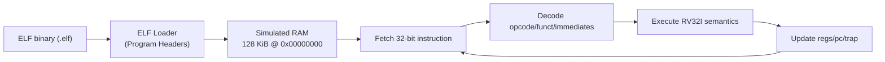

# RISC-V-SIM

An RV32I simulator I wrote in plain C. You give it a RISC-V ELF file and it runs
it one instruction at a time, with its own registers, memory, decoder and trap
handling. It doesn't need anything besides the C standard library.

It passes 41 of the 42 official rv32ui tests from riscv-tests, and the last one
is skipped on purpose (more on that below). I wrote about getting there on
[my site](https://www.joelmr.com/blog/is-my-risc-v-simulator-actually-right/).

## What it does

- 32 registers (`x0` to `x31`), `pc`, a step counter, and exit/trap state.
- 128 KiB of flat RAM with bounds and alignment checks.
- Loads little-endian ELF32 RISC-V executables (the `PT_LOAD` segments). It has
  its own ELF32 definitions, so there's no libelf.
- All of base RV32I.
- Programs exit through `ECALL` the Linux way (`a7 = 93`, exit code in `a0`).
- Traps on illegal instructions, misaligned access, going out of bounds,
  hitting the step limit, unsupported `ECALL`s, and `EBREAK`.
- It can print a trace of every instruction and dump all the registers.

## How it works



## Instructions

Everything in RV32I:

- `LUI`, `AUIPC`
- `JAL`, `JALR`
- `BEQ`, `BNE`, `BLT`, `BGE`, `BLTU`, `BGEU`
- `LB`, `LH`, `LW`, `LBU`, `LHU`
- `SB`, `SH`, `SW`
- `ADDI`, `SLTI`, `SLTIU`, `XORI`, `ORI`, `ANDI`, `SLLI`, `SRLI`, `SRAI`
- `ADD`, `SUB`, `SLL`, `SLT`, `SLTU`, `XOR`, `SRL`, `SRA`, `OR`, `AND`
- `FENCE`, and `FENCE.I` from Zifencei (both do nothing, since there's one hart
  and no caches)
- `ECALL`, `EBREAK`

## What you need

macOS or Linux, a C compiler (`cc`), and a RISC-V cross compiler. On macOS I got
it from Homebrew:

```bash
brew install riscv64-elf-binutils riscv64-elf-gcc
```

On Ubuntu the cross compiler is `gcc-riscv64-unknown-elf`, and you'll need to
add `RISCV_PREFIX=riscv64-unknown-elf` to the `make` commands.

## Build and run

```bash
make sim          # builds the simulator
make demo-elf     # builds the demo program (and a disassembly of it)
make demo-asm     # the demo's assembly, if you want to look at it
make run-demo     # runs the demo and dumps the registers
make test         # runs my own checks
```

You can also run the official RV32I tests (`rv32ui`) from
[riscv-tests](https://github.com/riscv-software-src/riscv-tests):

```bash
git clone https://github.com/riscv-software-src/riscv-tests
make riscv-tests RISCV_TESTS=riscv-tests
```

They build against my own tiny version of the riscv-tests environment
(`tests/riscv-tests/riscv_test.h`), which exits through `ECALL` instead of using
CSRs. `ma_data` gets skipped because it expects misaligned loads and stores to
work, and this simulator traps them on purpose. Right now that comes out to 41
passed, 0 failed and 1 skipped.

## Usage

```text
build/rv32i-sim <elf-path> [--max-steps N] [--dump-regs] [--trace]
```

Running the demo looks something like this:

```text
HALTED: yes
HALT_REASON: ECALL_EXIT
EXIT_CODE: 42
TRAP_CODE: 0
...
x10 ( a0): 0x0000002a
x17 ( a7): 0x0000005d
```

## Where stuff is

- `include/` has the headers (`cpu`, `memory`, `decode`, `elf_loader`)
- `src/` is the simulator itself
- `programs/` has the bare-metal demo program, its startup code and the linker
  script
- `tests/` has my checks and the riscv-tests runner

## What it doesn't do (yet)

- Only RV32I, so no `M`, `A`, `F`, `D` or `C` extensions
- No privilege levels or CSRs
- No interrupts or exceptions besides the simulator's own traps
- No memory-mapped I/O or peripherals
- No virtual memory

## Stuff I might add

- CSRs and privilege modes (basic M/S/U)
- A memory-mapped I/O device model
- More tests and better coverage
- An optional pipelined timing model
- A GDB remote stub so you can debug it interactively

## License

MIT
