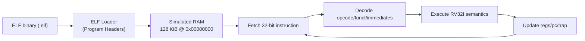

# RISC-V-SIM

A bare-metal RV32I instruction set simulator written in pure C. It runs compiled RISC-V binaries by simulating CPU state, memory, instruction decode, and execution.

This project demonstrates embedded/computer engineering fundamentals: ISA-level execution, binary loading, trap handling, and reproducible verification.

## Why This Project Matters

- Shows understanding of processor architecture at the instruction level.
- Demonstrates systems programming in C without runtime dependencies.
- Proves correctness with a full compile-load-execute test loop.

## Features

- RV32I CPU model with `x0..x31`, `pc`, step counter, exit/trap state.
- Flat 128 KiB RAM model with bounds and alignment checks.
- ELF32 loader for little-endian RISC-V executables (`PT_LOAD` segments).
- No external libelf dependency (portable local ELF32 definitions).
- Full base RV32I instruction execution.
- ECALL exit ABI support (`a7=93`, `a0=exit_code`).
- Trap handling for illegal instruction, misaligned access, bounds, step limit, unsupported ECALL, breakpoint.
- Optional instruction trace and full register dump.

## Architecture



## Supported RV32I Instructions

- `LUI`, `AUIPC`
- `JAL`, `JALR`
- `BEQ`, `BNE`, `BLT`, `BGE`, `BLTU`, `BGEU`
- `LB`, `LH`, `LW`, `LBU`, `LHU`
- `SB`, `SH`, `SW`
- `ADDI`, `SLTI`, `SLTIU`, `XORI`, `ORI`, `ANDI`, `SLLI`, `SRLI`, `SRAI`
- `ADD`, `SUB`, `SLL`, `SLT`, `SLTU`, `XOR`, `SRL`, `SRA`, `OR`, `AND`
- `FENCE`, and `FENCE.I` from Zifencei (both no-ops: one hart, no caches)
- `ECALL`, `EBREAK`

## Prerequisites

- macOS or Linux
- C compiler (`cc`)
- Homebrew packages for RISC-V cross-compilation:

```bash
brew install riscv64-elf-binutils riscv64-elf-gcc
```

## Build and Run

Build simulator:

```bash
make sim
```

Build demo RV32I binary and assembly/disassembly artifacts:

```bash
make demo-elf
make demo-asm
```

Run end-to-end demo:

```bash
make run-demo
```

Run automated checks:

```bash
make test
```

Run the official RV32I tests (`rv32ui`) from
[riscv-tests](https://github.com/riscv-software-src/riscv-tests):

```bash
git clone https://github.com/riscv-software-src/riscv-tests
make riscv-tests RISCV_TESTS=riscv-tests
```

They build against a small stand-in for the riscv-tests environment
(`tests/riscv-tests/riscv_test.h`) that exits through `ECALL` instead of
using CSRs. `ma_data` is skipped: it expects misaligned loads and stores to
work, and this simulator traps them instead.

On Ubuntu the cross compiler is `gcc-riscv64-unknown-elf`; add
`RISCV_PREFIX=riscv64-unknown-elf` to the `make` commands.

## CLI

```text
build/rv32i-sim <elf-path> [--max-steps N] [--dump-regs] [--trace]
```

## Example Output

```text
HALTED: yes
HALT_REASON: ECALL_EXIT
EXIT_CODE: 42
TRAP_CODE: 0
...
x10 ( a0): 0x0000002a
x17 ( a7): 0x0000005d
```

## Project Layout

- `include/`: public interfaces (`cpu`, `memory`, `decode`, `elf_loader`)
- `src/`: simulator implementation
- `programs/`: bare-metal demo program, startup, and linker script
- `tests/`: regression script

## Known Limitations (v1)

- RV32I only (no `M`, `A`, `F`, `D`, `C` extensions)
- No privilege levels or CSR model
- No interrupts/exceptions beyond simulator trap model
- No MMIO/peripherals
- No virtual memory

## Roadmap

- Add CSR + privilege modes (M/S/U basics)
- Add memory-mapped I/O device model
- Add instruction/coverage test suite expansion
- Add optional pipelined timing model
- Add GDB remote stub for interactive debugging
